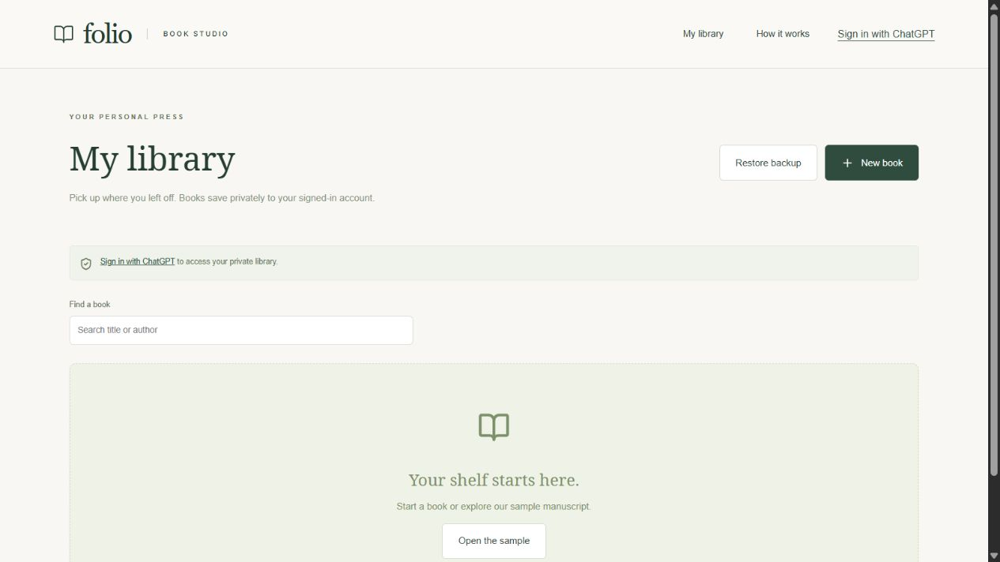
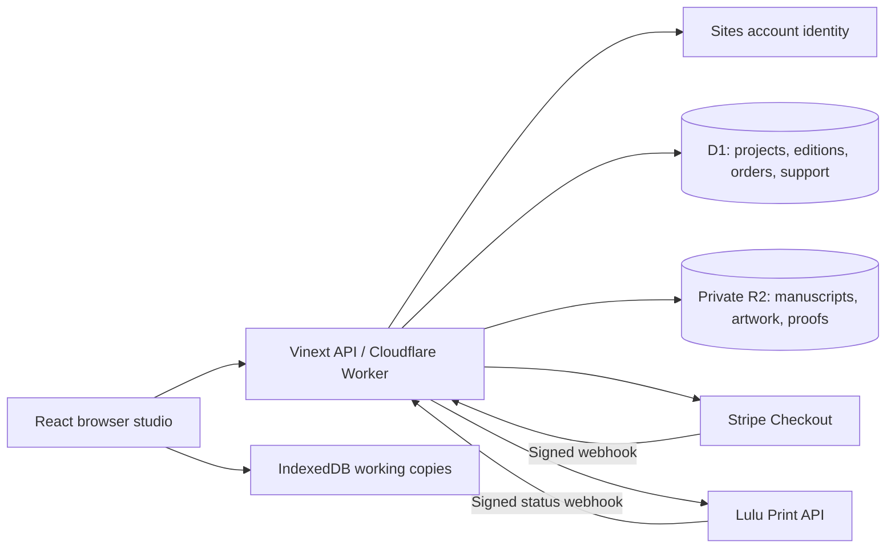

# Folio Book Studio

A full-stack web application that turns PDF and EPUB manuscripts into customizable book proofs, with private libraries and a sandbox print-order workflow.

**[Live demo](https://folio-book-studio.albert-chri.chatgpt.site/)** · [Launch guide](docs/LAUNCH.md) · [Operations and recovery](docs/OPERATIONS.md)

**Status:** Published portfolio project. Book preparation, PDF export, private storage, and sandbox payment/printing integrations are implemented. Real customer printing remains gated pending production setup, physical-proof inspection, and operational readiness.



## Try it

1. Open the live demo and choose **Explore a sample** to generate a PDF proof without supplying a manuscript.
2. Sign in with ChatGPT to save books to your private library.
3. Import a PDF or EPUB; adjust typography, illustrations, and cover artwork.
4. Review and download proofs or a complete project backup.

Sandbox checkout uses test payments and does not print or ship physical books. Printer approval is separate from digital-proof approval. Do not enter real payment information into a test checkout.

## Features

- PDF geometry preservation and page reordering; EPUB text reflow with embedded fonts, chapter starts, and configurable margins/gutters.
- Cover artwork, title overlays, illustration placement, and PDF page/book previews.
- Private account storage with owner-scoped authorization, SHA-256 file addressing, optimistic concurrency, and browser working copies.
- Immutable print editions, printer-sized full covers, Lulu preflight and price estimates.
- Stripe Checkout with signed webhook verification and durable protection against duplicate printer submissions.
- Order history, printer status updates, customer support threads, and an owner order desk.
- Project backups and full cloud-data exports with checksums and an isolated restore/validation tool.
- On-demand PDF/image modules, bounded parallel library loading, search, mobile layouts, keyboard navigation, and explicit save/error states.

## Architecture



The server derives the account namespace from authenticated identity. Manuscript downloads require ownership; printer downloads use expiring signed links. An atomic durable order transition prevents automatic resubmission after an uncertain printer request. Restores preserve those submission locks.

**Stack:** React 19, Vinext/Vite, Cloudflare Workers, D1/SQLite, R2, IndexedDB, pdf-lib, PDF.js, JSZip, Stripe, Lulu.

## Local development

Use Node.js 24 LTS and npm. From the repository root:

```sh
npm ci
npm test
npm run dev
```

Open the localhost URL printed by the development server. Local authenticated persistence and printing also require the D1/R2 bindings and runtime configuration described in [OPERATIONS.md](docs/OPERATIONS.md). Hosted account sign-in is supplied by Sites; a standalone clone does not include a production identity service. Secrets are optional for core tests and must never be added to browser code.

```sh
npm run build
```

This builds a Worker application, not a static HTML export. Copy `.env.example` only into ignored local configuration when connecting services; it contains setting names, not credentials. Keep checkout disabled until the launch requirements are met. Publishing the existing deployment uses its Sites project and source workflow; GitHub hosts this source repository, while Sites hosts the running application.

## Verification

The latest local suite passed **26 tests**, covering approval invalidation, PDF ordering and cover dimensions, account isolation, stale writes, content checksums, payment matching, signature validation, duplicate-submission protection, support isolation, backup restoration, and bounded request concurrency.

A sandbox payment created a Lulu sandbox job and received printer status callbacks. A live cloud-data backup was restored into an isolated local database/storage directory and compared against the archive. Provider-side disaster recovery and physical print quality remain unverified.

The main application JavaScript chunk decreased from 1,687,040 to 68,566 bytes after moving PDF/image tools into dynamic imports (about 96% smaller). This measures one uncompressed build chunk; shared dependencies and deferred downloads still exist. It is not a measured page-load-time improvement.

## Limitations and launch requirements

- Stripe and Lulu currently use sandbox credentials. Production accounts, billing, live webhooks, and a physical proof are needed before real orders.
- EPUB conversion supports a simplified layout; use a print-ready PDF for complex page designs.
- Business pricing/margins, policies, retention/deletion operations, and alerting need completion for a commercial launch.
- Full application backup/local restore is implemented; live hosting database/object-storage restoration requires provider support.
- Hosted sign-in requires a ChatGPT account. The latest fresh signed-in browser check was blocked by the authentication service's security-verification screen.

See [LAUNCH.md](docs/LAUNCH.md) for the owner checklist. This project demonstrates the implemented system without claiming production commerce readiness.

## References and assets

- [Lulu Print API](https://developers.lulu.com/)
- [Stripe Checkout](https://docs.stripe.com/payments/checkout)
- [Stripe webhook signatures](https://docs.stripe.com/webhooks)
- Noto Serif and Noto Sans fonts use the SIL Open Font License.

Sample manuscript text is included for demonstration. Uploaded user manuscripts, artwork, customer records, local backups, and integration secrets are excluded from this repository.
